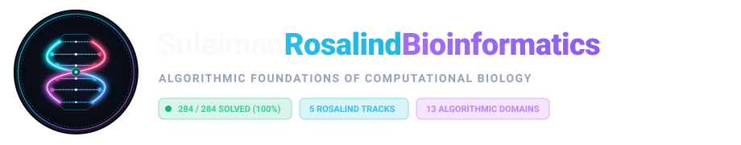

<div align="center">



# 🌐 SuleimanRosalindBioinformatics Web Portal
### Interactive Computational Biology Intelligence Hub & Algorithms Explorer

[](https://suleimanrosalindbioinformatics.github.io/)
[](https://github.com/SuleimanRosalindBioinformatics)
[](https://github.com/SuleimanRosalindBioinformatics/SuleimanRosalindBioinformatics)
[-green.svg?style=for-the-badge&logo=target)](http://rosalind.info/)
[](LICENSE)

<p align="center">
  <b>The browser-native interactive frontend presentation layer for 284 Rosalind computational biology problems, algorithms studio, and dynamic roadmap.</b>
</p>

[🚀 Visit Live Website](https://suleimanrosalindbioinformatics.github.io/) • [📦 Sibling Backend Repo](https://github.com/SuleimanRosalindBioinformatics/SuleimanRosalindBioinformatics) • [🏢 GitHub Organization](https://github.com/SuleimanRosalindBioinformatics)

---

</div>

## 📌 Portal Overview

**`SuleimanRosalindBioinformatics.github.io`** is the public-facing interactive web application for the **SuleimanRosalindBioinformatics Organization**. It serves as an interactive intelligence hub showcasing optimal solutions to all **284 published computational biology problems** on Rosalind.

### Key Interactive Features

1. **🔍 Master Problems Explorer**:
   - Filter and search through all 284 solved problems across all 5 Rosalind tracks: *Bioinformatics Textbook (BA1–BA11)*, *Bioinformatics Stronghold*, *Algorithmic Heights*, *Bioinformatics Armory*, and *Python Village*.
   - Filter by Difficulty Tier (Beginner, Intermediate, Advanced) and 13 Algorithmic Domains.
   - Interactive modal drawer showing Rosalind ID, problem classification, execution commands, and direct GitHub source code links.

2. **🧬 Live Bio-Algorithms Studio**:
   - **Central Dogma**: In-browser DNA-to-mRNA transcription ($T \to U$), reverse complementation, translation to peptide, and GC content calculation.
   - **GC Skew & OriC Origin of Replication**: Dynamic SVG trajectory visualization of $(G - C) / (G + C)$ identifying replication initiation zones.
   - **Hamming Distance & Point Mutations**: Calculates $d_H(s_1, s_2)$, transitions, transversions, and Ti/Tv ratios with visual base mismatch highlighting.
   - **Needleman-Wunsch Global Alignment**: Real-time dynamic programming alignment matrix computation with traceback and optimal scoring.
   - **Restriction Endonuclease Recognition Sites**: Scans DNA sequences for reverse palindromes of lengths 4–12 bp (Rosalind `REVP`).

3. **🗺️ 3-Tier Curriculum Roadmap**:
   - Pedagogical learning trajectory stratifying problems into Beginner (51), Intermediate (196), and Advanced (37) tiers.

4. **📚 13 Algorithmic Domains**:
   - Theoretical formulations and computational complexities covering Sequence Alignment, Genome Assembly, Hidden Markov Models, Phylogenetics, Mass Spectrometry, and Genome Rearrangements.

---

## 🗂️ Project Structure

```text
SuleimanRosalindBioinformatics.github.io/
├── index.html                  # Master responsive single-page web application
├── manifest.json               # Progressive web app metadata
├── .nojekyll                   # Bypasses Jekyll processing on GitHub Pages
├── favicon.svg                 # Scalable vector tab icon
├── favicon.png                 # 64x64 raster favicon
├── apple-touch-icon.png        # 180x180 iOS touch icon
├── assets/                     # Brand assets
│   ├── logo.svg                # Master vector brand logo
│   └── logo-icon.svg           # High-resolution vector icon
├── css/
│   └── style.css               # Modern design system, glassmorphism, responsive grid
├── js/
│   ├── app.js                  # Master application controller, search & filters, modal
│   └── bio-studio.js           # Live in-browser bioinformatic algorithms
└── data/
    ├── problems.json           # Structured database of all 284 problems
    ├── domains.json            # 13 Algorithmic domain classifications
    └── curriculum.json         # Tiers and tracks summary metrics
```

---

## 💻 Local Development & Preview

To preview the portal locally on your workstation:

```bash
# Navigate to the repository
cd /Users/macbookairm2/Documents/GitHub/SuleimanRosalindBioinformatics.github.io

# Launch a lightweight HTTP server
python3 -m http.server 8000
```

Then open `http://localhost:8000` in your web browser.

---

## 🌐 Connected Ecosystem

| Repository | Role | Direct Link |
| :--- | :--- | :--- |
| **Backend Core & Solutions** | 284 Solved problems, python algorithms, inputs/outputs, and wiki knowledge base | [SuleimanRosalindBioinformatics](https://github.com/SuleimanRosalindBioinformatics/SuleimanRosalindBioinformatics) |
| **Frontend Web Portal** | Interactive website, problems explorer, algorithm studio, and curriculum roadmap (This repo) | [SuleimanRosalindBioinformatics.github.io](https://github.com/SuleimanRosalindBioinformatics/SuleimanRosalindBioinformatics.github.io) |
| **GitHub Organization** | Central administrative organization | [SuleimanRosalindBioinformatics](https://github.com/SuleimanRosalindBioinformatics) |

---

## 📜 License
Distributed under the **MIT License**.

© 2026 **Suleiman Hajizadeh** • [SuleimanRosalindBioinformatics Organization](https://github.com/SuleimanRosalindBioinformatics)
